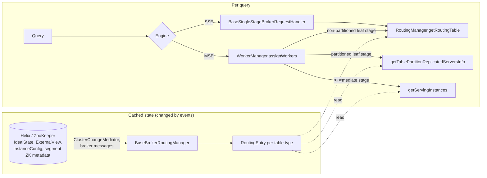
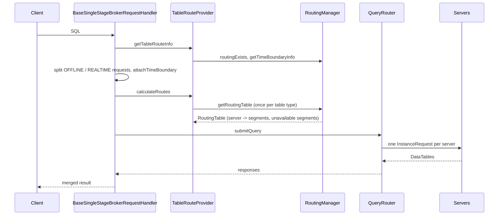

# Query routing

## TL;DR

- The broker keeps a **routing entry** for each table type (`myTable_OFFLINE`, `myTable_REALTIME`).
  Helix and controller events update the entries. Queries do not.
- For each query, the broker asks the routing entry for a **routing table**: the segments to query on each server.
  This step selects segments, prunes them with the query filter, and picks one server for each segment.
- **SSE** sends one request to each server in the routing table, then merges the responses.
- **MSE** uses the same routing table for leaf stages without a partition hint.
  Partitioned leaf stages and intermediate stages use other rules. See [MSE worker assignment](mse-worker-assignment.md).

## Big picture

The same diagram as a list:

1. Helix and ZooKeeper hold the cluster state.
   `BaseBrokerRoutingManager` reads it and keeps one `RoutingEntry` for each table type.
2. A query goes to the SSE handler or to the MSE planner.
3. The SSE handler calls `RoutingManager.getRoutingTable` for each table type of the query.
4. The MSE planner calls `WorkerManager.assignWorkers`. That method reads the routing entries in three different ways:
   - a non-partitioned leaf stage calls `getRoutingTable`, like SSE;
   - a partitioned leaf stage reads the partition metadata (`getTablePartitionReplicatedServersInfo`);
   - an intermediate stage reads the servers that host the tables (`getServingInstances`).

## Two kinds of state

The routing code has a clear split between cached state and per-query work.
This split explains most of its design.

| | Cached state | Per-query work |
|---|---|---|
| When it changes | On Helix events, controller messages, and failure detector callbacks | On each query |
| Cost | Can read ZooKeeper (slow) | Must not read ZooKeeper |
| Main classes | `RoutingEntry`, `SegmentStates`, `SegmentZkMetadataFetcher`, `TimeBoundaryManager`, `SegmentPartitionMetadataManager` | `SegmentSelector.select`, `SegmentPruner.prune`, `InstanceSelector.select`, `WorkerManager` |
| Lock | Global read/write lock, then a per-table build lock | None in `getRoutingTable`. It reads the state that the event handlers publish. |

See [Routing table](routing-table.md) for the events that change the cached state and for the per-query steps.

## SSE: one query

1. `BaseSingleStageBrokerRequestHandler` compiles the query.
   Then it picks a `TableRouteProvider`: `ImplicitHybridTableRouteProvider` for a physical table, `LogicalTableRouteProvider` for a logical table.
2. `getTableRouteInfo` finds the table types that exist, and the time boundary of a hybrid table.
3. For a hybrid table, the handler makes one request for each table type.
   `attachTimeBoundary` adds `time <= boundary` to the `OFFLINE` request and `time > boundary` to the `REALTIME` request.
4. `calculateRoutes` calls `RoutingManager.getRoutingTable` for each table type.
   See [Routing table](routing-table.md) for what this call does.
5. `QueryRouter.submitQuery` sends one `InstanceRequest` to each server of the routing table.
6. The handler merges the responses.
   It reports the unavailable segments in the response.

## MSE: summary

The MSE planner splits the query into stages.
`PinotDispatchPlanner` calls `WorkerManager.assignWorkers` to give each stage a list of workers.
The root stage always gets one worker on the broker.
The other stages get workers on servers.
See [MSE worker assignment](mse-worker-assignment.md).

## Where it is in the code

| Class | Module | Role |
|---|---|---|
| `RoutingManager` | pinot-core | Interface that the query handlers and the MSE planner use. |
| `BaseBrokerRoutingManager` | pinot-broker | Implementation. Keeps the routing entries and the server maps. |
| `RoutingTable`, `SegmentsToQuery` | pinot-core | Result of routing for one query and one table type. |
| `TableRouteProvider`, `ImplicitHybridTableRouteProvider`, `LogicalTableRouteProvider` | pinot-core | SSE: find the tables and table types of a query, and their routing. |
| `QueryRouter` | pinot-core | SSE: sends the requests to the servers and collects the responses. |
| `WorkerManager` | pinot-query-planner | MSE: assigns workers to stages. |
| `ClusterChangeMediator` | pinot-broker | Sends Helix changes to the routing manager. |

## Gotchas

- A routing table is per table type.
  A hybrid table gives two routing tables for one query.
- If the broker has no time boundary for a hybrid table, it silently drops the `OFFLINE` table from the query.
  This happens when the `OFFLINE` table has no segment with a valid end time, and the IdealState sets no explicit
  boundary. SSE and MSE both do this.
- SSE and the MSE leaf stage use the same routing table code.
  The MSE partitioned leaf stage and the MSE intermediate stages do not.
  A change to instance selection does not change them.
