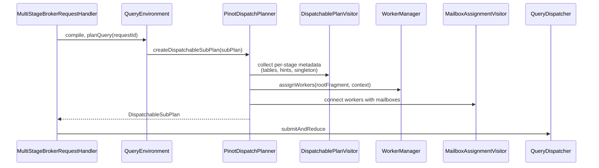
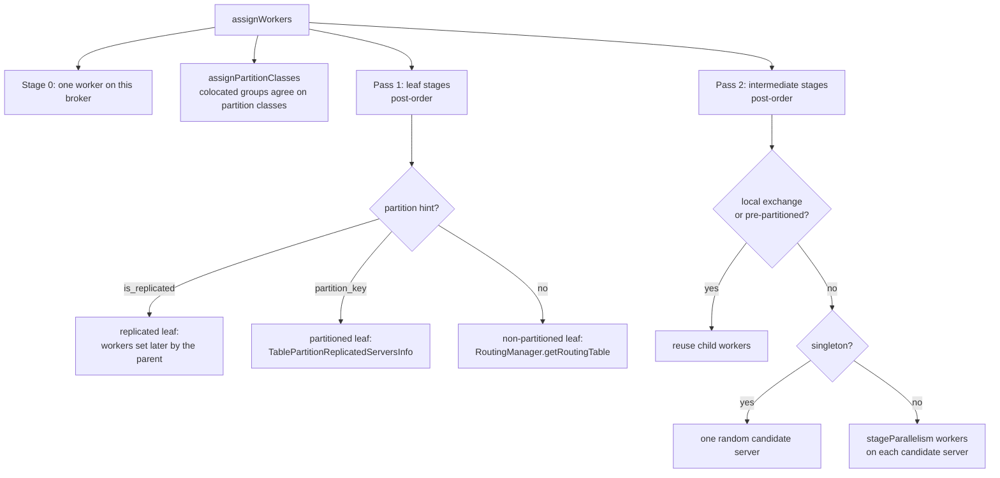

# MSE worker assignment

## TL;DR

- `PinotDispatchPlanner` calls `WorkerManager.assignWorkers` once for each query, after the plan is split into stages.
- The **root stage** (stage 0) always has one worker, on the broker that received the query.
- A **leaf stage** without a partition hint gets one worker for each server in the routing table of the table.
  This is the same routing table that SSE uses.
- A **leaf stage with a partition hint** gets one worker for each partition (or group of partitions).
  It picks servers from the partition metadata, and it does **not** use the instance selector.
- An **intermediate stage** reuses the workers of a child stage if the exchange is local.
  Otherwise it gets `stageParallelism` workers on **each server that hosts any segment of the scanned tables**.

This page describes the default planner path.
The physical optimizer (query option `usePhysicalOptimizer`) is in beta and uses other classes.
See [Physical optimizer](#physical-optimizer).

## Where it runs in the planner

1. `MultiStageBrokerRequestHandler` compiles the query and plans it with the request id.
2. `PinotDispatchPlanner.createDispatchableSubPlan` runs `DispatchablePlanVisitor`.
   This visitor fills a `DispatchablePlanMetadata` for each stage: scanned tables, table hints, and the singleton flag.
3. `WorkerManager.assignWorkers` fills the worker map of each stage (`workerIdToServerInstanceMap`).
   For leaf stages it also fills the segments of each worker (`workerIdToSegmentsMap`).
4. `MailboxAssignmentVisitor` connects the workers of each stage to the workers of its parent stage.
5. `QueryDispatcher` sends each worker its part of the plan.

## The two passes of `assignWorkers`

`assignWorkers` does these steps:

1. It gives stage 0 one worker on the broker itself.
2. `assignPartitionClasses` runs before any assignment.
   Leaf stages that join on the same partitioning form a colocated group.
   The group agrees on the partition classes that get a worker, so that worker *k* means the same partition in every member.
3. The first pass assigns leaf stages. The second pass assigns intermediate stages.
   Intermediate stages need the leaf results to know the candidate servers.
4. Each pass visits the stages in post-order, children first.
   With spools, the plan is a DAG. Each pass visits a stage only once.

## Leaf stages

### Non-partitioned leaf

`assignWorkersToNonPartitionedLeafFragment` handles a scan without a partition hint.

1. It calls `RoutingManager.getRoutingTable` for each table type.
   If broker pruning is on (`useBrokerPruning`, default `true`), the request carries the filter of the leaf stage. Then the pruners can remove segments.
   If pruning fails, it uses an unfiltered request.
2. For a hybrid table, it gets the time boundary.
   If there is no time boundary, it drops the `OFFLINE` routing table.
3. It gives one worker to each server in the routing tables, with the segments of that server.
   It sorts the servers by instance id, so worker ids are deterministic.

This path uses the instance selector of the table, with the request id of the query.
All modes of [instance selection](routing-table.md#instance-selection) apply: round robin, fixed replica, adaptive.

### Partitioned leaf

A scan gets a partition hint in one of two ways:

- The query has the hint `/*+ tableOptions(partition_key='...', partition_function='...', partition_size='...') */`.
- `inferPartitionHint` is on. Then `PinotImplicitTableHintRule` reads the partition config of the table with
  `WorkerManager.inferTableOptions`, and adds the hint.

`assignWorkersToPartitionedLeafFragment` handles these scans:

1. It reads `TablePartitionReplicatedServersInfo` from the routing manager.
   For each partition, this gives the segments and the **fully replicated servers**: the servers that hold all segments of the partition.
2. It makes sure that the hint matches the table config (key, function, and number of partitions).
3. Broker pruning removes the partitions in which all segments are pruned.
4. For each remaining partition, `pickEnabledServer` picks one fully replicated server.
   The index is `(requestId + partitionId) % numCandidates`, over the candidates sorted by name.
   Two scans of colocated tables pick the same server for the same partition.
5. If `partition_size` is smaller than the number of partitions, one worker gets many partitions.

### Replicated leaf

The hint `tableOptions(is_replicated='true')` marks a table that every server holds in full (for example, a dimension table).
The leaf stage gets no workers of its own.
The parent stage gives it the workers of a local exchange peer, or its own workers.
Each worker then scans the whole table locally.

### Lookup join

A lookup join reads a dimension table in memory on the server.
The join stage takes the workers of its input stage.

### Logical tables

`assignWorkersToNonPartitionedLeafFragmentForLogicalTable` handles a scan of a logical table.
It gets a routing table for each physical table.
Then it gives one worker to each server, with the segments of all physical tables on that server.

## Intermediate stages

`assignWorkersToIntermediateFragment` uses the first rule that matches:

| Rule | Condition | Workers |
|---|---|---|
| No tables | The query scans no table (for example, `SELECT 1`) | One worker on a random routable server. |
| Pre-partitioned | All children have the same partitioning, and the exchange keeps it | The workers of the first child. |
| Singleton | The stage needs one worker | One worker on a random candidate server. |
| Local exchange | A child has a local exchange | The workers of that child. |
| Default | Other cases | `stageParallelism` workers on each candidate server, sorted by instance id. |

A stage needs a single worker for:

- a final aggregation without `GROUP BY`;
- a window function without `PARTITION BY`;
- a final sort;
- a `FULL OUTER JOIN` without equality keys.

The **candidate servers** come from `getCandidateServers`:

- By default, the candidates are all servers that host any segment of a scanned table (`RoutingManager.getServingInstances`), minus the servers that are not routable.
  This includes all replicas, not only the servers that the leaf stages use.
- If `useLeafServerForIntermediateStage` is on, the candidates are the servers of the leaf stages of this query.

## Worker ids and determinism

Worker ids are significant.
In a pre-partitioned exchange, worker *N* of one stage sends to worker *N* of the next stage in the same process.
For this reason, the code sorts the servers by instance id before it gives out worker ids.

| Decision | Source of the choice |
|---|---|
| Non-partitioned leaf servers | Instance selector (request id, or adaptive stats) |
| Partitioned leaf servers | `(requestId + partitionId) % numCandidates` |
| Singleton intermediate stage | `Random` |
| No-table stage | `Random` |
| Other intermediate stages | All candidate servers, sorted |

## Configs and query options

| Name | Kind | Default | Effect |
|---|---|---|---|
| `stageParallelism` | Query option | 1 | Workers on each candidate server for an intermediate stage. |
| `useLeafServerForIntermediateStage` | Query option, or broker config `pinot.broker.multistage.use.leaf.server.for.intermediate.stage` | `false` | Intermediate stages run only on the leaf servers of the query. |
| `inferPartitionHint` | Query option, or broker config `pinot.broker.multistage.infer.partition.hint` | `false` | Adds partition hints from the table config. |
| `useBrokerPruning` | Query option, or broker config `pinot.broker.multistage.use.broker.pruning` | `true` | Sends the leaf filter to the pruners. |
| `pinot.broker.enable.partition.metadata.manager` | Broker config | `true` | Without it, partitioned leaf stages have no partition metadata. |
| `tableOptions` hint | Query hint | none | `partition_key`, `partition_function`, `partition_size`, `partition_parallelism`, `is_replicated`. |

## Physical optimizer

The physical optimizer (`usePhysicalOptimizer`) is a beta planner path.
It does not use `WorkerManager.assignWorkers`.
`LeafStageWorkerAssignmentRule` assigns leaf workers, and `WorkerExchangeAssignmentRule` assigns the other workers.
Lite mode (`useLiteMode`) and `runInBroker` exist only in this path.

## Invariants

- Stage 0 has exactly one worker, on the broker.
- All leaf stages are assigned before any intermediate stage.
- In a colocated group, worker *k* means the same partition class in every member.
- A stage gets workers only once, also when the plan is a DAG.

## Gotchas

- An intermediate stage runs on every server that hosts a replica of a scanned table, not only on the servers that the
  leaf stages use. With 3 replicas, it uses about 3 times more servers than the leaf stages.
  `useLeafServerForIntermediateStage` changes this.
- The partitioned leaf does not use the instance selector.
  Adaptive selection, `numReplicaGroupsToQuery`, `orderedPreferredPools`, and fixed replica do not apply to it.
- The partitioned leaf picks servers from the **enabled** server map, not the routable map.
  It can give a worker to a server that the failure detector excluded.
- Each leaf stage calls `getRoutingTable` on its own.
  With round robin, two scans of one table get the same servers, because they use the same request id.
  With adaptive selection, they can get different servers.
- The MSE does not support optional segments. A non-partitioned leaf drops the new segments that the instance selector marks as optional.
