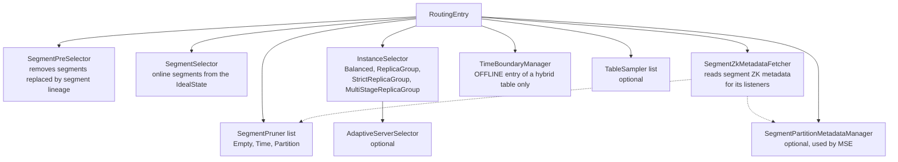
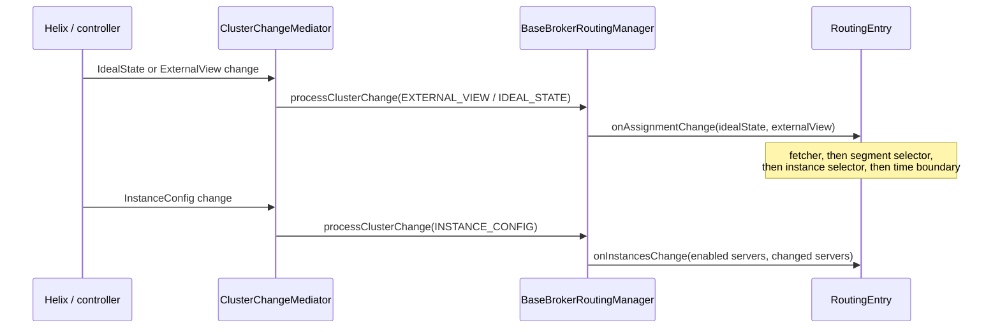
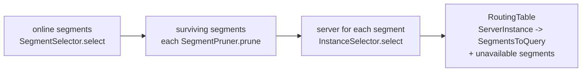
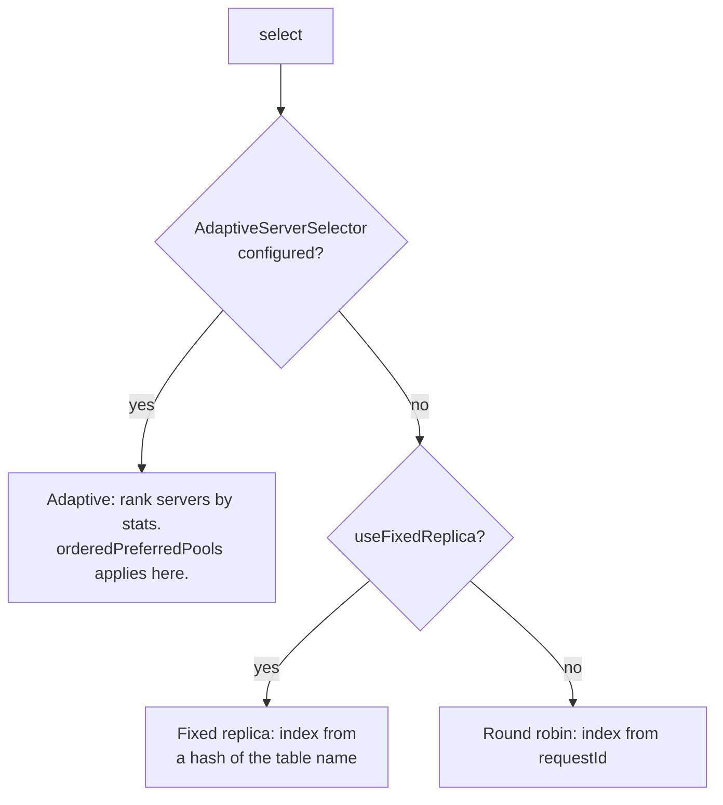

# Routing table

## TL;DR

- `BaseBrokerRoutingManager` keeps one `RoutingEntry` for each table type.
  A routing entry holds a segment selector, a list of segment pruners, an instance selector, and optional managers
  for the time boundary and the partition metadata.
- Helix changes, controller messages, and the failure detector update the routing entries.
  ZooKeeper reads happen here, never on the query path.
- For one query, `RoutingEntry.calculateRouting` does three steps on the cached state:
  select the online segments, prune them with the query filter, and pick one server for each segment.
- The online segments come from the **IdealState**. The health of each replica comes from the **ExternalView**.

## Contents of a routing entry

`BaseBrokerRoutingManager.buildRoutingInternal` creates the routing entry of a table type.
It reads the table config, the IdealState, and the ExternalView, then creates these parts:

| Part | Created when | Role |
|---|---|---|
| `SegmentPreSelector` | Always | Removes the segments that segment lineage marks as replaced (for example, by a merge task). |
| `SegmentSelector` | Always | Keeps the set of online segments: the segments that are `ONLINE` or `CONSUMING` in the IdealState. |
| `SegmentPruner` list | Table config needs it | See [Pruning](#pruning). |
| `InstanceSelector` | Always | Keeps the candidate servers of each segment, and picks one for each query. |
| `AdaptiveServerSelector` | Broker config `pinot.broker.adaptive.server.selector.type` is not `NO_OP` | Ranks servers by in-flight requests, latency, or both. |
| `SegmentZkMetadataFetcher` | Always | Reads segment ZK metadata in bulk and sends it to its listeners (pruners, partition metadata manager). |
| `TimeBoundaryManager` | `OFFLINE` entry, when the `REALTIME` table also exists | Computes the time boundary of a hybrid table. |
| `SegmentPartitionMetadataManager` | The table has exactly one partition column, and `pinot.broker.enable.partition.metadata.manager` is `true` (default) | Keeps, for each partition, its segments and the servers that hold all of them. The MSE uses it. |
| `TableSampler` list | Table config has `tableSamplers` | Extra segment selector and instance selector for the query option `sampler`. |

## Events that change a routing entry

| Event | Source | Effect |
|---|---|---|
| Table becomes `ONLINE` in the broker resource | `BrokerResourceOnlineOfflineStateModelFactory` | `buildRouting` creates the routing entry. |
| IdealState or ExternalView change | `ClusterChangeMediator` | `onAssignmentChange` on each entry whose IdealState or ExternalView version changed. |
| InstanceConfig change | `ClusterChangeMediator` | Recomputes the enabled servers. Calls `onInstancesChange` on all entries. |
| Segment refresh message | `BrokerUserDefinedMessageHandlerFactory` | `refreshSegment` reads the ZK metadata of one segment again. |
| Table config change message | `BrokerUserDefinedMessageHandlerFactory` | `buildRouting` creates the routing entry again. |
| Server fails or recovers | Failure detector | `excludeServerFromRouting` or `includeServerToRouting`. Calls `onInstancesChange` on all entries. |
| Periodic check (every hour) | `ClusterChangeMediator` | Processes the changes again, in case a Helix callback was lost. |

`ClusterChangeMediator` processes changes in a background thread.
Many Helix callbacks of the same type become one update.

## One query: `calculateRouting`

`RoutingManager.getRoutingTable(brokerRequest, requestId)` finds the routing entry and calls `calculateRouting`.

1. `selectThenPrune` gets the online segments from the segment selector.
2. `selectThenPrune` gives the segments to each pruner, in order.
   Each pruner returns the segments that it cannot remove.
3. The instance selector picks one server for each surviving segment.
   Segments without a usable server become **unavailable segments**.
4. `getServerInstanceToSegmentsMap` converts instance ids to `ServerInstance` objects from the enabled server map.
   It drops servers that have only optional segments.

The query handlers, the MSE planner, and broker pruning all call `selectThenPrune`.
This makes sure that they all see the same segments.

## Pruning

`SegmentPrunerFactory.getSegmentPruners` creates the pruners in this order:

| Order | Pruner | Enabled by | Removes a segment when |
|---|---|---|---|
| 1 | `EmptySegmentPruner` | `TableConfigUtils.needsEmptySegmentPruner` | the segment has no rows |
| 2 | `TimeSegmentPruner` | `routing.segmentPrunerTypes` contains `time` | the time range of the segment does not match the filter |
| 3 | `SinglePartitionColumnSegmentPruner` or `MultiPartitionColumnsSegmentPruner` | `routing.segmentPrunerTypes` contains `partition` | the partition of the segment does not match the filter |

All pruners get the segment metadata from `SegmentZkMetadataFetcher`.
They do not read ZooKeeper during a query.

## Instance selection

`InstanceSelectorFactory` creates the instance selector from `routing.instanceSelectorType` in the table config.

| Type | Class | Behavior |
|---|---|---|
| `balanced` (default) | `BalancedInstanceSelector` | Spreads the segments over all replicas. Segment *i* goes to candidate `(requestId + i) % numCandidates`. |
| `replicaGroup` | `ReplicaGroupInstanceSelector` | Uses the same candidate index for all segments. With mirror segment assignment, this touches the fewest servers. |
| `strictReplicaGroup` | `StrictReplicaGroupInstanceSelector` | Like `replicaGroup`. Also, if a replica is unavailable for one old segment of a partition, it removes that replica for the whole partition. Upsert and dedup tables need this. |
| `multiStageReplicaGroup` | `MultiStageReplicaGroupSelector` | Uses the InstancePartitions, not the IdealState, to find replica groups. Picks replica group `requestId % numReplicaGroups`. Beta. |
| Other value | Loaded as a class name | Plugin. |

`BaseInstanceSelector` has the logic that all selectors share:

- **Candidates.** The candidates of a segment are its replicas in the ExternalView that are `ONLINE` or `CONSUMING`,
  and on an enabled, routable server.
- **New segments.** A segment is new if it is younger than `pinot.broker.new.segment.expiration.seconds`
  (5 minutes by default), and the ExternalView did not converge for it.
  The broker never reports a new segment as unavailable. It sends it as an optional segment.
- **Unavailable segments.** An old segment is unavailable when it has no candidate.
  The broker reports it in the query response.
- **Segment groups.** Segments with the same candidates share one `CandidateGroup`.
  The selection works on groups, not on single segments.

### Modes of selection

The selection mode depends on the broker config, the table config, and the query options:

- **Round robin** (default). The candidate index comes from the request id.
  Two calls with the same request id give the same servers.
- **Fixed replica.** The candidate index comes from a hash of the table name.
  Enable it with the broker config `pinot.broker.use.fixed.replica`, the table config, or the query option `useFixedReplica`.
- **Adaptive.** `PriorityPoolInstanceSelector` ranks servers with the stats of `ServerRoutingStatsManager`.
  `BalancedInstanceSelector` ranks again for each segment group.
  The replica group selectors take one ranking for the whole query.
  Adaptive selection and fixed replica cannot be enabled together. The selector constructor fails.

The query option `numReplicaGroupsToQuery` spreads a query over more than one replica group.
The replica group selectors use it.

## Hybrid tables: the time boundary

`TimeBoundaryManager` belongs to the `OFFLINE` routing entry.
It keeps the end time of each online `OFFLINE` segment.

- If the IdealState of the `OFFLINE` table has the field `HYBRID_TABLE_TIME_BOUNDARY`, that value is the boundary.
- Otherwise, the boundary is the maximum segment end time minus an offset.
  The offset is 1 hour if the table push frequency is `HOURLY` and the time unit is not `DAYS`. Otherwise, it is 1 day.
- If no segment has a valid end time, there is no boundary.
  Then the broker drops the `OFFLINE` table from the query, without an error.

The query handler adds `time <= boundary` to the `OFFLINE` query and `time > boundary` to the `REALTIME` query.
The MSE leaf stage adds the same filters on the server, in `ServerPlanRequestUtils`.

## Configs and query options

| Name | Kind | Default | Effect |
|---|---|---|---|
| `routing.instanceSelectorType` | Table config | `balanced` | Instance selector type. |
| `routing.segmentPrunerTypes` | Table config | none | Pruners: `time`, `partition`. |
| `routing.useFixedReplica` | Table config | broker value | Fixed replica mode for one table. |
| `pinot.broker.use.fixed.replica` | Broker config | `false` | Fixed replica mode for all tables. |
| `pinot.broker.new.segment.expiration.seconds` | Broker config | 300 | Age limit of a new segment. |
| `pinot.broker.adaptive.server.selector.type` | Broker config | `NO_OP` | `NUM_INFLIGHT_REQ`, `LATENCY`, or `HYBRID`. |
| `pinot.broker.enable.partition.metadata.manager` | Broker config | `true` | Creates `SegmentPartitionMetadataManager`. |
| `useFixedReplica` | Query option | config | Fixed replica mode for one query. |
| `numReplicaGroupsToQuery` | Query option | 1 | Number of replica groups for one query. |
| `orderedPreferredPools` | Query option | none | Preferred server pools. Only adaptive selection reads it. |
| `sampler` | Query option | none | Name of a table sampler. |

## Invariants

- The query path does not read ZooKeeper.
- Every caller gets the segments of a query through `selectThenPrune`.
  A second copy of this sequence lets the MSE planner and the query see different segments.
- The selection is deterministic for a given request id, except in adaptive mode.

## Gotchas

- The online segments come from the IdealState, but the candidates come from the ExternalView.
  During an update, the parts of one routing entry can briefly disagree.
- `orderedPreferredPools` has no effect without adaptive selection.
- A server can leave the enabled server map between instance selection and `getServerInstanceToSegmentsMap`.
  Then the broker drops its segments and increments the meter `SERVER_MISSING_FOR_ROUTING`.
- A server that holds only optional (new) segments gets no request.
